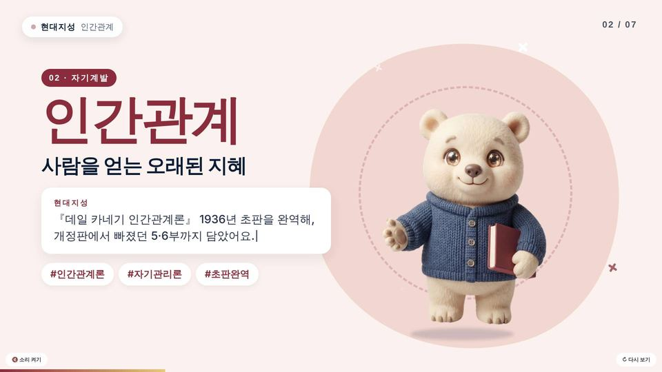
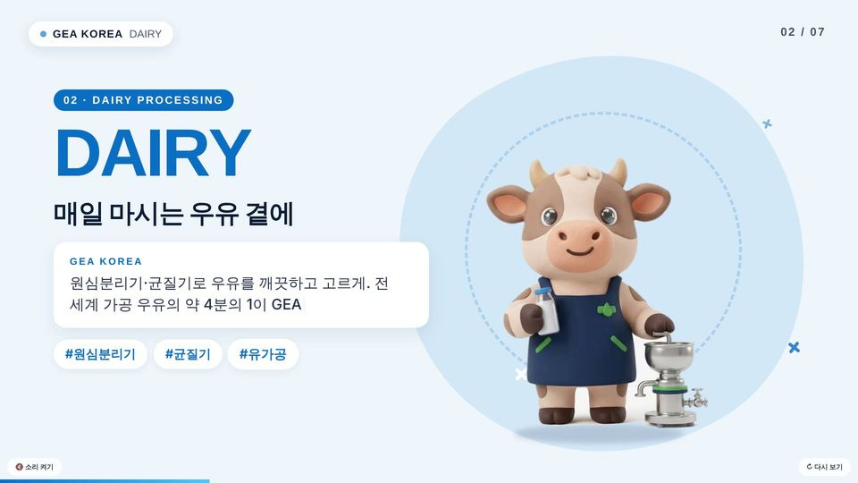
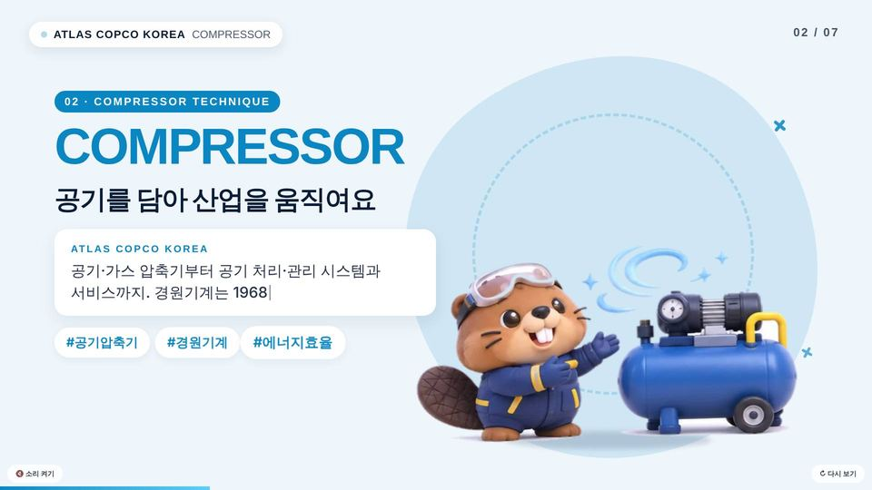
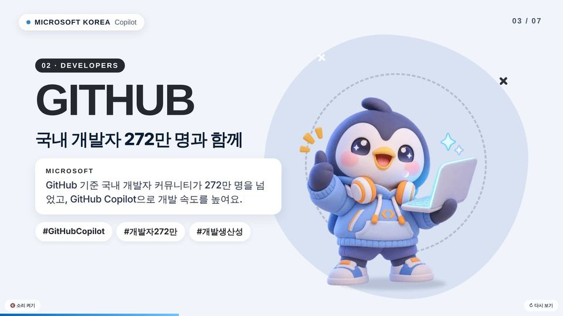
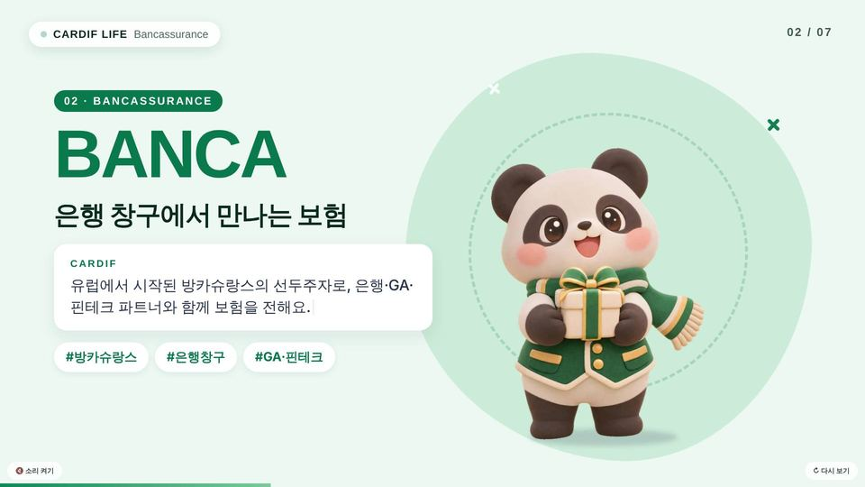
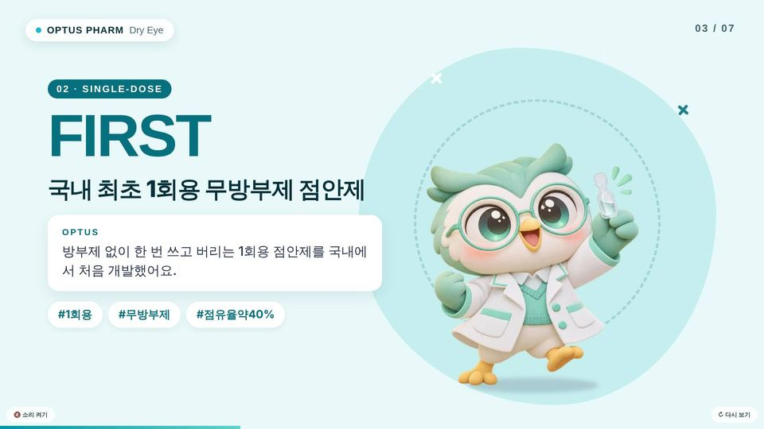
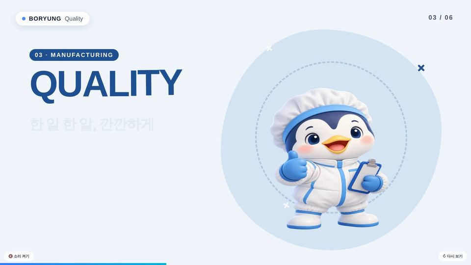
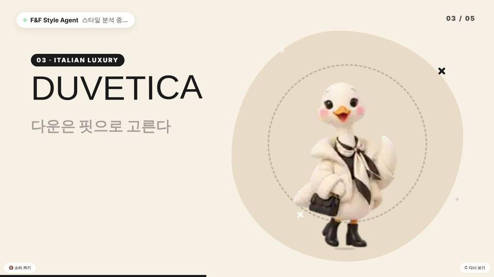

# 🎬 클레이 모션 필름 (Clay Motion Film)

**회사 정보만 넣으면, 귀여운 클레이 3D 캐릭터가 회사를 소개하는 1분짜리 모션 필름이 완성됩니다.**
캐릭터 이미지와 배경음악은 **Gemini**가 만들고, HTML 모션 엔진이 연혁·사업·제품을 담아 한 편의 영상처럼 재생해요. 결과물은 HTML 파일 하나라 어디서나 바로 열립니다.

### ▶ 전체 필름 보기: https://youni202.github.io/clay-motion-film/

## 지금까지 만든 필름

썸네일을 누르면 필름이 바로 재생돼요. (소리와 함께 보기 버튼을 눌러 주세요)

<table>
<tr><td width="50%" align="center"><a href="https://youni202.github.io/clay-motion-film/films/hyundaejisung.html"></a><br><b>현대지성</b><br><sub>대표 도서로 보는 44년 출판 이야기</sub></td><td width="50%" align="center"><a href="https://youni202.github.io/clay-motion-film/films/gea-korea.html"></a><br><b>GEA 코리아</b><br><sub>식품·음료·제약 공정 기술</sub></td></tr>
<tr><td width="50%" align="center"><a href="https://youni202.github.io/clay-motion-film/films/atlas-copco-korea.html"></a><br><b>아트라스콥코 코리아</b><br><sub>압축기·진공·조립·파워</sub></td><td width="50%" align="center"><a href="https://youni202.github.io/clay-motion-film/films/mskorea.html"></a><br><b>한국마이크로소프트</b><br><sub>Copilot·Azure로 여는 AI 전환</sub></td></tr>
<tr><td width="50%" align="center"><a href="https://youni202.github.io/clay-motion-film/films/cardif.html"></a><br><b>BNP파리바 카디프생명</b><br><sub>일상을 지키는 보장</sub></td><td width="50%" align="center"><a href="https://youni202.github.io/clay-motion-film/films/optus.html"></a><br><b>옵투스제약</b><br><sub>국내 최초 1회용 무방부제 점안제</sub></td></tr>
<tr><td width="50%" align="center"><a href="https://youni202.github.io/clay-motion-film/films/boryung.html"></a><br><b>보령</b><br><sub>연혁과 대표 제품</sub></td><td width="50%" align="center"><a href="https://youni202.github.io/clay-motion-film/films/fnf.html"></a><br><b>F&F</b><br><sub>브랜드별 캐릭터로 만나는 스타일</sub></td></tr>
</table>

## 필름은 이렇게 구성돼요 (약 54초)

| 순서 | 장면 | 내용 |
|---|---|---|
| 1 | 인트로 | 창립 연도부터 올해까지 숫자가 올라가고, 캐릭터들이 고개를 내밀어요 |
| 2 | 연혁 | 주요 이력 6~8개를 타임라인으로 |
| 3~7 | 사업·강점 | 사업 분야마다 캐릭터 한 명 + 한 줄 카피 + 타이핑되는 설명 + 해시태그 |
| 8 | 제품·서가 | 대표 제품(또는 책)을 박스로 진열 |
| 9 | 피날레 | 모든 캐릭터가 모여 마무리 문구 |

## 만드는 방법 3가지

### 1) AI 에이전트에게 링크만 주기
Claude 같은 코딩 에이전트에게 이렇게 말하면 됩니다.
> "https://github.com/youni202/clay-motion-film 으로 ○○ 회사 소개 모션 필름 만들어줘"

에이전트가 [`AGENTS.md`](AGENTS.md)의 절차대로 **회사 조사 → 기획(film.json) → Gemini로 캐릭터·음악 생성 → 빌드 → 화면 점검**까지 진행해요.

### 2) GitHub Actions 버튼 한 번
1. 이 저장소를 Fork(복사)합니다.
2. **Settings → Secrets and variables → Actions**에 `GEMINI_API_KEY`를 추가합니다. ([키 발급](https://aistudio.google.com/apikey))
3. **Actions → 🎬 Make film → Run workflow**에서 회사 이름과 폴더 이름(영문)을 입력합니다.

Gemini가 구글 검색으로 회사를 조사해 기획안을 만들고, 이미지·음악까지 생성해 GitHub Pages에 올려 줘요.
처음에는 **stop_after_plan**을 체크해서 기획안(`films/<이름>/film.json`)의 사실 관계를 먼저 확인하는 걸 추천해요.

### 3) 내 컴퓨터에서 직접
```bash
pip install -r requirements.txt            # ffmpeg 필요
export GEMINI_API_KEY=...
python scripts/plan_film.py "현대지성" hyundaejisung      # 회사 조사 + 기획안 초안
python scripts/gen_assets.py films/hyundaejisung           # Gemini 캐릭터 이미지 + 음악
python scripts/build.py films/hyundaejisung                # → dist/hyundaejisung/index.html
node scripts/preview.js dist/hyundaejisung/index.html      # 장면별 스크린샷으로 점검
```
**API 키가 없다면?** `python scripts/prompts.py films/<이름>`이 Gemini 앱에 그대로 붙여 넣을 프롬프트를 출력해요.
Gemini 앱에서 만든 이미지·음악을 `films/<이름>/assets/`에 넣고 `build.py`를 실행하면 됩니다.

## 폴더 구조
```
engine/template.html   모션 엔진 (1920×1080 무대, 화면 크기에 맞춰 자동 확대·축소)
scripts/               기획·생성·빌드·미리보기 스크립트
films/<이름>/          film.json(기획안) + assets/(캐릭터 png, bgm.mp3) — 필름 하나당 폴더 하나
docs/                  소개 페이지와 완성된 필름 (GitHub Pages)
```
`film.json`에서 문구, 색상, 캐릭터, 음악 분위기, 장면 길이를 바꿀 수 있어요 → [항목 설명](docs/FILM_SCHEMA.md)

## 참고하세요
- 회사 로고·상표와 책 표지는 그리지 않아요. 브랜드명과 책 제목은 글자로만 표시합니다.
- 필름 속 연도·수치·제품명은 회사 공식 자료를 기준으로 정리했어요. 공개적으로 쓰기 전에 한 번 더 확인해 주세요. 보험·제약·금융처럼 광고 심의가 있는 업종은 특히 주의가 필요해요.
- Gemini API로 이미지·음악을 만들면 사용량만큼 요금이 나와요. 필름 한 편에 이미지 7장, 음악 1곡 정도입니다.
- 모델 이름은 자주 바뀌어서, `scripts/gemini.py`가 여러 후보를 차례로 시도해요. 환경변수 `GEMINI_IMAGE_MODEL`, `GEMINI_MUSIC_MODEL`, `GEMINI_TEXT_MODEL`로 직접 지정할 수도 있어요.
